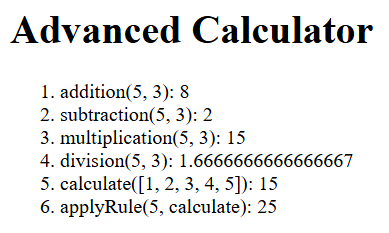

# Advanced Calculator

A Vite page that prints six results from `src/advancedCalculator.ts`.

## Description

From this folder, `npm run dev` starts it. This run was Vite 8.2.0 at http://localhost:5173/. The tab title is **ts-calculator**. The heading is "Advanced Calculator".

`src/style.css` is one comment, so it does not set a font or a background. In this browser the heading is Times New Roman at 32px and the list is Times New Roman at 16px, both black. The shot is on white. Nothing on the page is a button.

The list is ordered. These are the six lines:

1. `addition(5, 3)` is 8
2. `subtraction(5, 3)` is 2
3. `multiplication(5, 3)` is 15
4. `division(5, 3)` is `1.6666666666666667`
5. `calculate([1, 2, 3, 4, 5])` adds the numbers and is 15
6. `applyRule(5, calculate)` passes 5 to `calculate`. A single number is squared, so the result is 25

Loading the module also logs those six lines in the console, numbered the same way.

The four arithmetic functions throw `Both arguments must be numbers` when an argument is not a number. `division` returns `null` when the second number is 0. This page calls the six lines above.

## Screenshots



## Getting Started

### Dependencies

* Node.js and npm
* This run used Vite 8.2.0

### Installing

```bash
npm install
```

### Executing program

```bash
npm run dev
```

This run opened http://localhost:5173/.

## Help

`src/style.css` is one comment, so the page uses the browser's default type. The four arithmetic functions throw `Both arguments must be numbers` when an argument is not a number. `division` returns `null` when the second number is 0. This page does not call those paths.

## Authors

[Mamadou Moussa Balde](https://www.linkedin.com/in/2mb/)

## Version History

* Current local run
    * Vite 8.2.0 at http://localhost:5173/
    * The six results above are what the page printed

## License

This folder does not include a `LICENSE.md` file.

## Acknowledgments

* [README template](https://gist.github.com/DomPizzie/7a5ff55ffa9081f2de27c315f5018afc)
